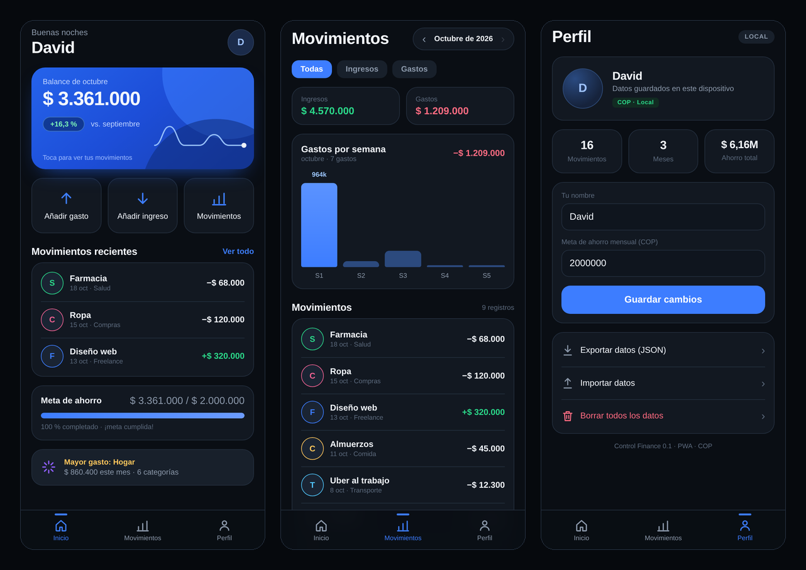

# Control Finance

App de finanzas personales, **mobile-first y local-first**, para registrar ingresos
y gastos reales, ver el balance del mes, tu meta de ahorro y en qué categorías se
va tu dinero.

Hecha como PWA: se instala desde Safari en iPhone (o Chrome en Android) y
funciona sin conexión. Los datos viven en el dispositivo y se pueden exportar
o importar en JSON.

**App en vivo:** <https://bydavidp.github.io/Control_Finance/>



## Instalar en iPhone

1. Abre <https://bydavidp.github.io/Control_Finance/> en **Safari**.
2. Toca **Compartir → Añadir a pantalla de inicio**.
3. Ábrela desde el icono: se ve a pantalla completa y funciona sin conexión.

## Funcionalidad (v0.1)

- Alta de **ingresos y gastos** con monto, categoría, descripción y fecha.
- **Balance del mes**, comparación con el mes anterior y desglose de ingresos/gastos.
- **Movimientos por mes** (navegación ‹ ›), filtros y detalle con eliminación.
- **Gastos por semana** calculados con datos reales.
- **Meta de ahorro** configurable y progreso.
- **Perfil**: nombre, meta, estadísticas, exportar/importar JSON y borrado total.
- **Sin backend**: persistencia en `localStorage`, privacidad por defecto.
- PWA instalable y con app shell offline.

## Stack

- HTML + CSS + JavaScript vanilla (sin build, sin dependencias).
- `localStorage` versionado (`controlfinance.v1`).
- Service worker para uso offline.
- GitHub Pages + GitHub Actions para despliegue.

## Desarrollo local

```bash
cd web
python3 -m http.server 8000
```

Abre `http://localhost:8000`. Para probar en el teléfono dentro de la misma Wi-Fi,
usa la IP del equipo.

Parámetros útiles:

| URL | Efecto |
|---|---|
| `?demo=1` | Carga datos de ejemplo si no hay datos guardados |
| `?tab=movimientos` | Abre una pestaña concreta |
| `?static=1` | Desactiva animaciones (capturas) |

## Tests manuales rápidos

1. Primer arranque: aparece la bienvenida.
2. «Probar con datos de ejemplo» → balance y lista con datos.
3. Añadir gasto → el balance baja y el movimiento aparece.
4. Recargar → los datos siguen ahí (localStorage).
5. Filtros Ingresos/Gastos, navegación de meses y borrar movimiento.
6. Exportar JSON → importarlo en otro navegador.

## Despliegue

El workflow `.github/workflows/pages.yml` publica `web/` en GitHub Pages en cada
push a `main`.

1. En GitHub: **Settings → Pages → Build and deployment → Source: GitHub Actions**.
2. Push a `main`.
3. La app queda en `https://bydavidp.github.io/Control_Finance/`.

HTTPS es necesario para que funcione el service worker y la instalación como PWA.

## Hoja de ruta

- [ ] **v0.2** — Presupuestos por categoría, movimientos recurrentes y búsqueda.
- [ ] **v0.3** — Backend con Supabase (auth + Postgres + RLS) y sincronización
      entre dispositivos, manteniendo el modo local como fallback.
- [ ] **v0.4** — Open finance en Colombia con Belvo (conexión bancaria) y
      conciliación automática.
- [ ] **v1.0** — Multimoneda, informes exportables y widgets.

## Privacidad

La versión actual no envía datos a ningún servidor: todo se guarda en el
navegador del dispositivo. Si borras los datos del sitio o el navegador los
desaloja, se pierden; usa **Exportar datos** para respaldos.

## Aviso

Es una herramienta de registro personal, no asesoría financiera ni contable.
